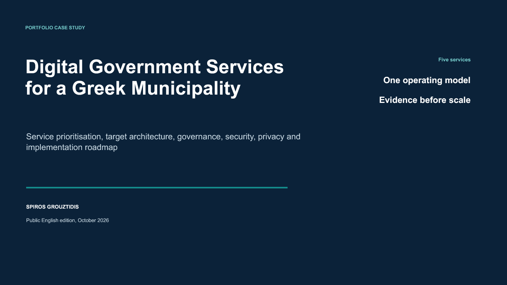

# Digital Government Services for a Greek Municipality

[](https://github.com/spirosgro/digital-government-services-case-study/actions/workflows/validate.yml)
[](LICENSE.md)
[](LICENSE-CODE)

A decision-oriented case study for designing five citizen-facing services for a hypothetical
medium-sized Greek municipality. The repository moves from policy context to service sequencing,
architecture, governance, security, privacy, accessibility, and measurable implementation.

> **Core finding:** begin with infrastructure issue reporting and appointment booking, then add
> certificate and payment services after the municipality has tested its integration, identity,
> recovery, and operating controls.



## What this project demonstrates

- Transparent prioritisation of five municipal services with reproducible weighted scoring.
- A layered target architecture that separates resident channels, domain services, integration,
  legacy systems, operational data, and monitoring.
- A security and privacy register tied to evidence that reviewers can test before launch.
- A RACI model and governance gates that assign responsibility beyond initial delivery.
- A phased roadmap with accessibility, assisted service, recovery, and adoption built into acceptance.

## Service portfolio

| Rank | Candidate service | Score | Delivery wave |
|---:|---|---:|---|
| 1 | Infrastructure issue reporting | 4.28 | Pilot |
| 2 | Facility booking and appointments | 4.10 | Pilot |
| 3 | Digital certificate issuance | 3.95 | Integrate |
| 4 | Municipal debt payments | 3.85 | Integrate |
| 5 | Digital participation platform | 3.35 | Expand |

Scores are design hypotheses on a five-point scale. The method, weights, inputs, and limitations
are documented so that another reviewer can challenge or replace them.

## Repository contents

- [Full report](report/digital-government-services-case-study.pdf) and
  [editable Word version](report/digital-government-services-case-study.docx)
- [Presentation](presentation/digital-government-services-case-study.pdf) and
  [editable PowerPoint version](presentation/digital-government-services-case-study.pptx)
- [Service prioritisation](analysis/service-prioritization.md) with reusable CSV input
- [Target architecture](architecture/target-architecture.md)
- [Governance and RACI](governance/operating-model.md)
- [Security and privacy register](risk/security-privacy-register.md)
- [Implementation roadmap](roadmap/implementation-roadmap.md)
- [Methodology and limitations](docs/methodology-and-limitations.md)
- [References](references/references.md)

## Reproduce the analysis

Python 3.10 or later is sufficient; the scripts use only the standard library.

```bash
python scripts/calculate_scores.py
python scripts/validate_repo.py
```

## Scope and responsible use

This is an educational portfolio artifact based on a hypothetical municipality. It contains no
citizen records, municipal systems, credentials, or confidential operational data. Roadmap dates,
scores, and architecture choices are illustrative. A real authority must validate user needs,
costs, national law, regulatory scope, procurement terms, accessibility, security, and operations.

The public edition removes student identifiers and does not distribute the original university
submission.

## License and citation

Documentation is available under [CC BY 4.0](LICENSE.md). Code under `scripts/` uses the
[MIT License](LICENSE-CODE). Citation metadata is provided in [CITATION.cff](CITATION.cff).
