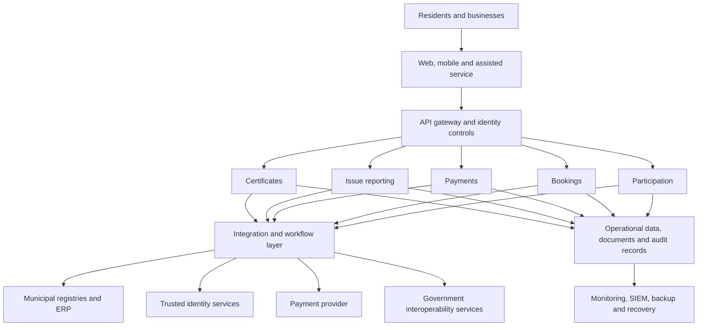

# Target architecture

The proposed architecture separates citizen channels from domain services and legacy systems.
This keeps the public interface consistent while allowing each municipal service to evolve at a
controlled pace.

## Design decisions

| Decision | Rationale | Required evidence |
|---|---|---|
| API-first integration | Limits direct coupling to legacy applications | Versioned API contracts and integration tests |
| Shared identity and access layer | Avoids inconsistent authentication between services | MFA policy, RBAC matrix, access reviews |
| Hosted payment page | Keeps card data outside municipal systems | Provider assurance and reconciliation controls |
| Central audit pipeline | Supports incident response and accountability | Protected log retention and monitoring coverage |
| Data minimisation by service | Reduces privacy exposure and simplifies retention | Data inventory, lawful basis, retention schedule |
| Assisted digital channel | Preserves access for residents who cannot use self-service | Service desk procedure and adoption metrics |

The diagram is a reference architecture, not a procurement specification. Product selection
follows workload, national interoperability requirements, support capacity, and exit planning.
